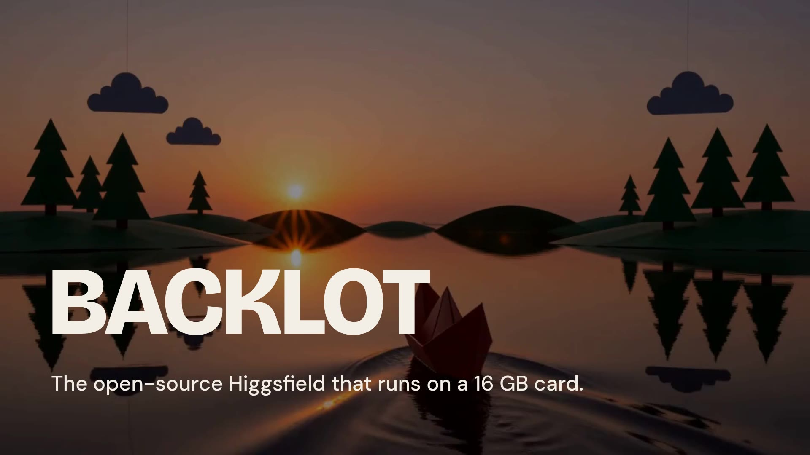

# Backlot

**The open-source Higgsfield that runs on a 16 GB card.**

A local, open-weights video and image studio on your own ComfyUI, driven through the
**Comfy Developer Platform API** (Comfy SDK). One window, no node graphs, the GPU you already own.

Built for the Comfy [Open Source Higgsfield](https://www.comfy.org/open-source-higgsfield) challenge.

## Demo (2 minutes)

[](https://demos.onpointfl.com/backlot/)

Click the poster to watch, or [open the MP4 directly](https://demos.onpointfl.com/backlot/backlot-demo.mp4).

## What it does

**Video (MiniMax H3, 24 fps, with sound)**
- Text to video, image to video (the first frame is center-cropped, never stretched).
- Reference mode: up to 9 reference images and 3 reference audio clips keep a person, product or
  place consistent across new shots (Ref2VA).
- 360 Orbit: one photo (or three) becomes a full turntable spin (ORB360 LoRA).
- Latent chaining: continue a clip from its last latent, so a scene can run as long as you like
  without a visible join (Motion Context).
- Camera Motion LoRA, SeedVR2 or RealESRGAN upscaling, RIFE interpolation, 2x slow motion.
- A second video model: LTX-2.5 distilled (text and image to video with audio) for fast drafts,
  two-stage pixel pipeline straight from ComfyUI's template, on the same backend.

**Stills (Krea 2 Turbo, Qwen Image 2.1, Qwen Image Edit 2511, MOSS-Image)**
- Text to image, image to image, style reference, identity edit (same face and outfit in a new
  scene), instruction edit, and camera angles (re-shoot a photo from 96 camera positions).
- Transparent PNG output, vertical crops for phones, SeedVR2 4K upscale.
- MOSS-Image for anything with words on it: posters, menus, cards, book pages. Text mode renders
  the words you quote; Layout mode is a poster form (headline, lines, illustration, footer, URL) and
  each block lands where you put it.

**Audio (YuE2, Stable Audio 3 Medium)**
- Song: lyrics and a style line become a full song with vocals (YuE2 3B, 48 kHz), with optional
  LoRA flavors (voice, genre, instrumental). Sound FX: any effect, ambience or music bed up to 45 s
  from one sentence. Everything is loudness-normalized to MP3.

Every render is sent as a job through the Comfy SDK. Locally the SDK talks to
[`comfy-api-proxy`](https://pypi.org/project/comfy-api-proxy/), which serves the Comfy API in front
of a plain ComfyUI. Point `BACKLOT_COMFY_URL` at Comfy Cloud and nothing else changes.

All models are open weights. No partner nodes, no closed APIs. Full list with download links in
[docs/models.md](docs/models.md).

## Moves, Cinema Studio, Apps

Three tabs added Oct 20 2026 after taking Higgsfield's product apart (the teardown is in
`research/higgsfield/`). Same models, no new downloads.

**Moves.** 30 one-click camera moves and effects: push in, pull back, dolly zoom, orbit left and
right, FPV drone, aerial reveal, crane, whip pan, macro, earth zoom out, disintegration and more.
Pick a card, describe the subject in a sentence, optionally start from a photo, and Backlot writes
the prompt the Camera Motion LoRA was trained on. Every card has a preview rendered on this app.

**Cinema Studio.** Direct the look with pickers instead of prose: genre, era, light, camera body,
lens, aperture and pacing. Backlot composes one prompt in H3's own multi-shot format, with cut
times and camera moves per shot, so a calm three-shot scene or a chaotic ten-cut one renders as a
single clip with the same subject across every cut. The prompt is shown before you render and you
can edit it.

**Apps.** One input, one job: Angles (re-shoot a photo from 96 camera positions), Relight, Cutout
(real RGBA), 4K Upscale, 360 Orbit, and Character Swap (put a new face, hair and outfit on the
person in a clip; motion, lip sync and sound stay).

## What this costs elsewhere

Higgsfield's own plan table (captured Oct 20 2026) prices a five-second 720p Seedance clip at about
22 credits, so the $59/month Plus plan buys roughly 640 such clips a month, and 130 at 4K. Backlot
renders a five-second clip in about five minutes on a 16 GB card for the cost of electricity, with
no clip cap, no queue, and nothing leaving the machine.

## Requirements

- Linux (tested on Ubuntu 24.04) or macOS, Python 3.10+.
- A ComfyUI install (0.35 or newer; **0.38 or newer for Qwen Image 2.1**, **0.42 or newer for MOSS-Image**; YuE2 and Stable Audio 3 nodes are core since 0.38; LTX-2.5 nodes are core in 0.42; everything here was last run on 0.42.1) with these node packs in `custom_nodes/`:
  - [city96/ComfyUI-GGUF](https://github.com/city96/ComfyUI-GGUF)
  - [kijai/ComfyUI-KJNodes](https://github.com/kijai/ComfyUI-KJNodes)
  - [jlucasmcrell/ComfyUI-H3-Multishot](https://github.com/jlucasmcrell/ComfyUI-H3-Multishot)
  - [NikoDemon80/ComfyUI-H3-Motion-Context](https://github.com/NikoDemon80/ComfyUI-H3-Motion-Context)
  - [Fannovel16/ComfyUI-Frame-Interpolation](https://github.com/Fannovel16/ComfyUI-Frame-Interpolation)
  - [numz/ComfyUI-SeedVR2_VideoUpscaler](https://github.com/numz/ComfyUI-SeedVR2_VideoUpscaler)
  - [lbouaraba/comfyui-krea2edit](https://github.com/lbouaraba/comfyui-krea2edit) (identity edit only)

  `setup/install-nodes.sh /path/to/ComfyUI` clones all of them.
- An NVIDIA GPU with 16 GB VRAM. Everything here was measured on an RTX 4070 Ti SUPER (16 GB).
  More VRAM only makes it faster.
- About 100 GB of disk for the required models, 170 GB for all of them.
- `ffmpeg` and `ffprobe` on PATH (slow motion and upscale need them).

## Setup

```bash
git clone https://github.com/Arfolomew/backlot
cd backlot
python3 -m venv .venv && .venv/bin/pip install -r requirements.txt

# node packs + models into your ComfyUI
setup/install-nodes.sh ~/ComfyUI
setup/download-models.sh ~/ComfyUI            # required set (~100 GB)
setup/download-models.sh ~/ComfyUI --all      # every optional mode too
```

Start ComfyUI with these flags (they are what keeps H3 inside 16 GB):

```bash
python main.py --listen 127.0.0.1 --port 8188 --disable-pinned-memory --fast-disk --reserve-vram 0.4 --use-ck-attention
```

Then:

```bash
./start.sh          # starts the Comfy API proxy on :8199 and the studio on :8801, opens it
./stop.sh           # stops both (ComfyUI keeps running)
```

If your ComfyUI is somewhere else: `COMFYUI_URL=http://127.0.0.1:8189 ./start.sh`.

### Desktop icon (optional)

```bash
setup/install-launcher.sh            # app menu + desktop icon (Linux), Backlot.command on the Desktop (macOS)
setup/install-launcher.sh --remove   # undo
```

Anything `start.sh` reads from the environment can be baked in, e.g.
`PORT=8802 COMFYUI_URL=http://127.0.0.1:8189 setup/install-launcher.sh`. If the icon cannot
start Backlot (usually because ComfyUI is not running) you get a desktop notification pointing at
`launch.log` instead of a silent failure.

## Closing the window hands the GPU back

ComfyUI keeps the last model resident (up to ~15 GB for H3) until something else needs the
room. Backlot watches for its own windows: when the last one closes and nothing is rendering,
it asks ComfyUI to drop its weights about ten seconds later, so the card is free for whatever
you do next. A reload or a second tab cancels it; a render in flight finishes first. The app
and the proxy keep running quietly (`./stop.sh` ends them) and ComfyUI itself is never stopped.

## Renders are jobs

Every render endpoint can run as a background job: send `X-Backlot-Async: 1`, get a job id
back at once, and poll `/api/jobs/<id>` (202 while running, then the normal response). The
page does this for everything, which is why a reload mid-render picks the result back up and
why a 7-minute H3 clip survives a reverse proxy's request timeout. Without the header the
same endpoints answer inline, so scripts and curl keep working as before.

## Exposing it beyond localhost

Set `BACKLOT_PASSWORD` and every request needs HTTP Basic auth (any username, that password).
Backlot binds to 127.0.0.1 only; put a tunnel in front of it, for example
[cloudflared](https://developers.cloudflare.com/cloudflare-one/connections/connect-networks/):

```bash
BACKLOT_PASSWORD='something-long' ./start.sh
cloudflared tunnel --url http://127.0.0.1:8801      # quick tunnel, prints a public URL
```

Anyone with the URL and the password can spend your GPU, so keep both private.

## Configuration

Everything is an environment variable; `start.sh` sets the first two for you.

| Variable | Default | Meaning |
|---|---|---|
| `BACKLOT_PASSWORD` | unset | If set, HTTP Basic auth on every request (any username). Use when the app is exposed beyond localhost. |
| `BACKLOT_COMFY_URL` | `http://127.0.0.1:8199` | Comfy API endpoint (the local proxy, or Comfy Cloud). |
| `BACKLOT_COMFYUI_URL` | `http://127.0.0.1:8188` | The plain ComfyUI behind it. Used only by the Free VRAM button. |
| `BACKLOT_QWEN_URL` | same as `BACKLOT_COMFY_URL` | Optional second Comfy API endpoint (a second proxy) if Qwen Image 2.1 runs on a different ComfyUI, e.g. a newer install. Backlot frees one backend's VRAM before using the other. |
| `BACKLOT_OUTPUT_DIR` | `./output` | Where videos and images are filed (`videos/`, `images/`). |
| `BACKLOT_COMFY_OUTPUT_DIR` | unset | ComfyUI's output folder. Lets latent chaining list the clips it has saved. |
| `BACKLOT_VIDEO_DIR`, `BACKLOT_IMAGE_DIR`, `BACKLOT_AUDIO_DIR`, `BACKLOT_META_DIR` | `<output>/videos` etc. | Point any one folder at a library you already have. |
| `PORT` | `8801` | App port. |

## How it is built

```
app/server.py           the HTTP app: one route per feature, builds a graph, submits it
app/comfy_backend.py    the Comfy SDK adapter: assets in, jobs out, nothing else touches ComfyUI
app/workflows/          one graph builder per model family (H3, Ref2VA, Krea 2, SeedVR2, post-fx)
app/index.html          the UI, plain HTML and JavaScript, no build step
app/prompts/            the 360 Orbit prompts
docs/models.md          every model file, where it comes from, where it goes
setup/                  node-pack and model download scripts
```

Inputs are uploaded with `client.assets.from_bytes()` and dropped into `LoadImage` /
`LoadVideo` / `LoadAudio` nodes as asset references. Graphs are submitted with
`client.submit()`, waited on with `job.wait()`, and the Save node's output is read back with
`output.to_bytes()`. The app never writes into ComfyUI's input folder and never reads its output
folder, which is what makes it run unchanged against the cloud.

## Measured timings (RTX 4070 Ti SUPER, 16 GB, through the SDK and proxy)

| Job | Time |
|---|---|
| Krea 2 Turbo still, 1152x768, 12 steps | 55 s cold (model load), about 15 s warm |
| SeedVR2 2x upscale of that still | 16 s |
| H3 text to video, 3 s at 1024x576, 8 steps | 116 s |
| H3 image to video, 3 s at 1024x576 | 156 s |
| H3 reference video, 1 ref, 3 s at 1024x576 | 186 s |
| 360 Orbit, 1 photo, 5.2 s at 1152x768 | 406 s |
| Latent chain, clip 2 continuing clip 1 (3 s each) | 164 s + 174 s, join drift 2.9/255 mean pixel difference |
| Qwen Image 2.1 still, 1152x768, 8 steps | 21 s warm |
| Qwen Image 2.1 instruction edit, about 1 MP | 26 s |
| MOSS-Image still, 992x1504, 25 steps | 25 s cold, about 16 s warm |
| MOSS-Image layout poster, 6 blocks, 992x1504 | 22 s |
| LTX-2.5 text to video, 5 s at 1344x768, with audio | 62 s |
| LTX-2.5 image to video, 4 s at 1344x768 | 56 s |
| YuE2 song, 30 s, plan off, 32 steps | 14 s |
| Stable Audio 3 sound effect, 6 s, 8 steps | 6 s |
| H3 text to video, 5 s at 1344x768 | about 7.5 min |

H3 is slow on 16 GB because the 13.6 GB text encoder has to run on the CPU. That is the trade
the whole project is built around: it works on the card most people actually have.

## Recipes that took real renders to find

- H3's Qwen3-VL text encoder must stay on the CPU (`clip_cpu`) or dequantization OOMs on a 16 GB card.
- Krea 2's `EmptyFlux2LatentImage` is a //16 latent but the VAE decodes at 8x: ask the latent for
  2x the size, and hand `Flux2Scheduler` the real size or skin goes waxy.
- The Camera Motion LoRA's trigger words must lead the prompt.
- Latent chaining must stay sequential; chaining through a PNG loses the join (about 15% pixel drift).
- SeedVR2 keeps pores, lashes and lettering where RealESRGAN smooths them to plastic.

## License

MIT. Model weights carry their own licenses; see each source in [docs/models.md](docs/models.md).
